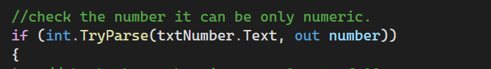
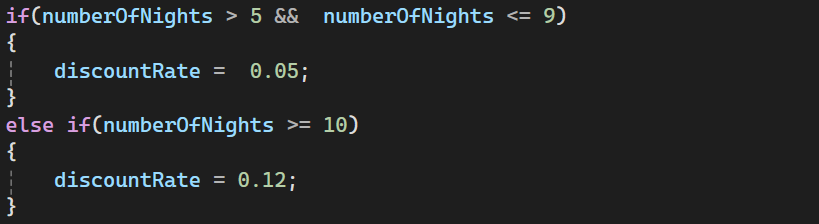
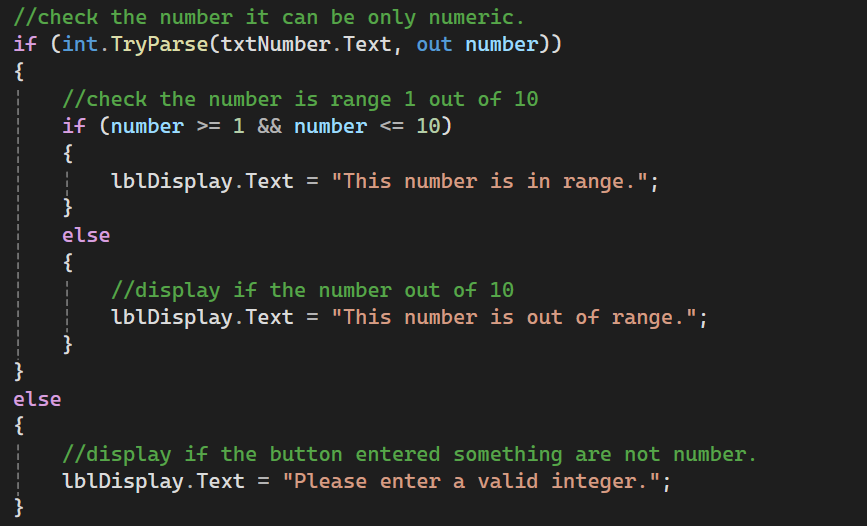
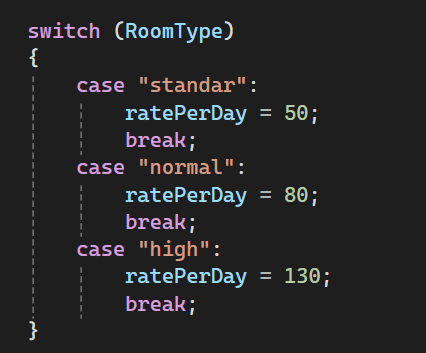

# Making Decisions in C#

### Chapter 3: Decision Structures with Windows Forms

*Based on: Starting Out with Visual C# (6th Edition), Tony Gaddis*

---

##  About This Project

This project demonstrates how a C# program makes decisions using **if**, **if-else**, **nested if**, and **switch** statements, together with **TryParse** for safe user input.

---

>  Save each screenshot in the `screenshots` folder using the exact file names above, and the images will appear automatically.

---

## 1️ `if` Statement with TryParse

**Purpose:** Checks that the user entered a valid number before using it, which prevents conversion exceptions.

**Syntax:**
`int.TryParse(textBox1.Text, out hours)`

- `TryParse` returns `true` if the conversion succeeds, `false` otherwise.
- The `out` keyword is required.
- `TryParse` only checks the *type*. Use an `if` with `&&` to also check that the value is *reasonable* (for example, `hours > 0 && hours <= 168`).

### Screenshot 1

---

## 2️ `if-else` Statement

**Purpose:** Runs one block when the condition is `true` and a different block when it is `false`.

**Syntax:**
`if (expression) { ... } else { ... }`

###  Screenshot 2

---

## 3️ Nested `if`

**Purpose:** Tests more than one condition by placing one decision inside another ("one inside another").

**Syntax:**
`if (expression) { if (expression) { ... } else { ... } } else { ... }`

**Example idea:** A loan qualifies only if salary is at least 40,000 **and** years on the job is at least 2.

###  Screenshot 3

---

## 4️ `switch` Statement

**Purpose:** Lets the value of a variable or expression choose which path the program takes. It is an alternative to a long `if-else-if` chain that tests the same variable.

**Syntax:**
`switch (testExpression) { case value1: ... break; case value2: ... break; default: ... break; }`

- Each `case` ends with `break`.
- `default` is optional and runs when no case matches.

### 📸 Screenshot 4

---

## Quick Comparison

| Statement | Best used when |
|---|---|
| `if` | One condition to check |
| `if-else` | Two possible outcomes |
| Nested `if` | Several dependent conditions |
| `switch` | One variable with many fixed values |
| `TryParse` | Reading numbers from user input safely |

---

##  How to Run

1. Open the project in **Visual Studio**.
2. Press **F5** (or click  Start).
3. Enter values in the form and click the button to see the result.

---

*Made with using C# and Windows Forms.*
