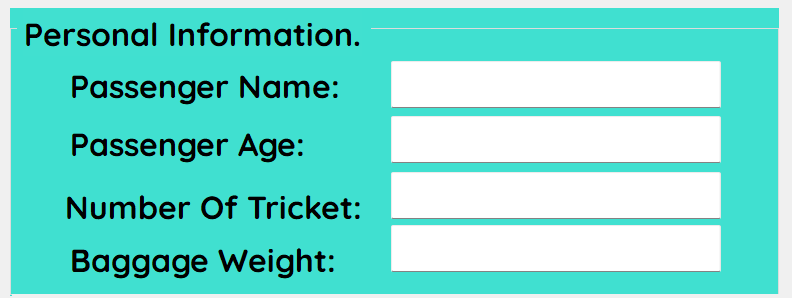
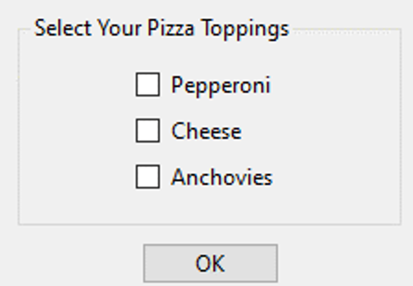
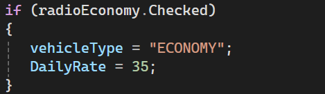
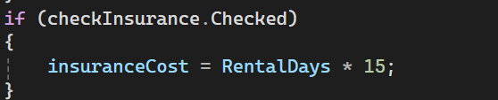
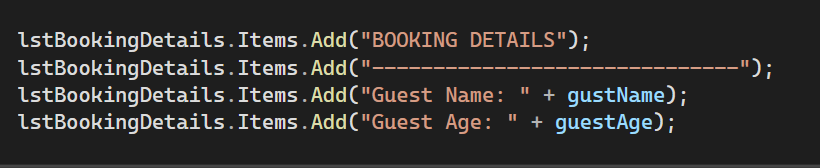
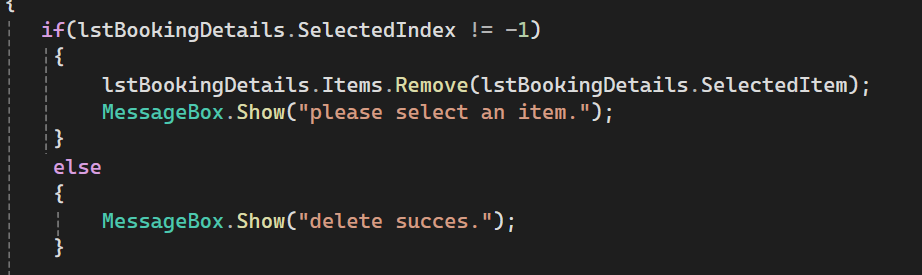
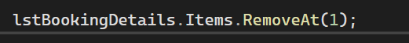
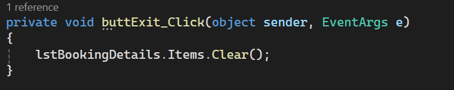

 #  Windows Forms Controls in C#

### GroupBox, Panel, RadioButton, CheckBox and ListBox

*Based on: Starting Out with Visual C# (6th Edition), Tony Gaddis, Chapter 3*

---

## About This Project

This project demonstrates common Windows Forms controls and how C# code responds to the user's choices. Each section gives a **definition**, the key **properties/methods**, a **code example**, and a **screenshot**.

---

## Contents

| # | Topic | Screenshot file |
|:-:|---|---|
| 1 | GroupBox | `1_groupbox.png` |
| 2 | Panel | `2_panel.png` |
| 3 | RadioButton | `3_radiobutton.png` |
| 4 | CheckBox | `4_checkbox.png` |
| 5 | ListBox: Items.Add | `5_listbox_add.png` |
| 6 | ListBox: Items.Remove | `6_listbox_remove.png` |
| 7 | ListBox: Items.RemoveAt | `7_listbox_removeat.png` |
| 8 | ListBox: Items.Clear | `8_listbox_clear.png` |

> Save the screenshots in a folder named `screenshots` using the exact file names above. If this README is inside the screenshots folder, remove `screenshots/` from the image paths.

---

## 1️ GroupBox

**Definition:** A **GroupBox** is a container control that holds other controls inside a box with a **title (caption)**. It is mainly used to organize related controls and to make radio buttons work in **separate groups**.

**Key points:**
- `Text` property sets the caption shown at the top of the box.
- Radio buttons placed in the same GroupBox are mutually exclusive, so each GroupBox acts as its own independent group.
- Moving the GroupBox moves all controls inside it. 

### Screenshot 1

---

## 2️ Panel

**Definition:** A **Panel** is a container control that groups other controls **without a caption**. It can have a border and can show scroll bars when its contents are larger than the panel.

**Key points:**
- Has no `Text` caption (unlike GroupBox).
- `BorderStyle` sets the border (None, FixedSingle, Fixed3D).
- `BackColor` can give the group a different color.
- `AutoScroll = true` adds scroll bars when needed.
- Radio buttons inside the same Panel also form their own group.

### Screenshot 2

---

## 3️ RadioButton

**Definition:** A **RadioButton** lets the user select **one choice from several**. Clicking one radio button automatically **deselects** the others in the same group (**mutually exclusive selection**).

**Common properties:**

| Property | Description |
|---|---|
| `Text` | Text displayed next to the radio button |
| `Checked` | Boolean: `true` if selected, `false` if not |

### Screenshot 3

---

## 4️ CheckBox

**Definition:** A **CheckBox** gives the user an option such as true/false or yes/no. Unlike radio buttons, the user can select **multiple** check boxes at the same time.

**Common properties:**

| Property | Description |
|---|---|
| `Text` | Text displayed next to the check box |
| `Checked` | Boolean: `true` if checked, `false` if not |

 
###  Screenshot 4

---

## 5️⃣ ListBox: Items.Add

**Definition:** A **ListBox** control displays a list of items and allows the user to select an item from the list. The `Items.Add` method **adds an item** to the ListBox.

**Common properties:**

| Property | Description |
|---|---|
| `Text` | Text of the currently selected item |
| `Items` | The items in the ListBox |
| `Items.Count` | Number of items |
| `SelectedItem` | The currently selected item |
| `SelectedIndex` | Zero-based index of the selected item (**-1** if none) |

**Syntax:** `ListBox.Items.Add(NewItem);`

###  Screenshot 5

---

## 6️ ListBox: Items.Remove

**Definition:** The `Items.Remove` method **removes a specific item** from the ListBox, using the item's value.

**Syntax:** `ListBox.Items.Remove(Item);`

**Code:**

daysListBox.Items.Remove("Tuesday");  

###  Screenshot 6

---

## 7️ ListBox: Items.RemoveAt

**Definition:** The `Items.RemoveAt` method **removes the item at a specific index**. Indexes start at **0**, so the first item is index 0 and the nth item is index n – 1.

**Syntax:** `ListBox.Items.RemoveAt(Index);`

**Code:**

daysListBox.Items.RemoveAt(2);  

⚠️ The index must be valid. It cannot be less than 0, or greater than or equal to the number of items. Otherwise an **exception** is thrown.

###  Screenshot 7

---

## 8️ ListBox: Items.Clear

**Definition:** The `Items.Clear` method **erases all items** in the ListBox.

**Syntax:** `ListBox.Items.Clear();`

### Screenshot 8

---

## Quick Comparison

| Control / Method | Purpose |
|---|---|
| GroupBox | Container **with** a caption |
| Panel | Container **without** a caption (can scroll) |
| RadioButton | Choose **one** option |
| CheckBox | Choose **many** options |
| `Items.Add` | Add an item |
| `Items.Remove` | Remove an item by value |
| `Items.RemoveAt` | Remove an item by index |
| `Items.Clear` | Remove all items |

---

##  How to Run

1. Open the project in **Visual Studio**.
2. Press **F5** (or click  Start).
3. Test each control and take the screenshots.

---

*Made with  using C# and Windows Forms.*