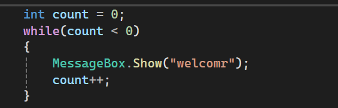
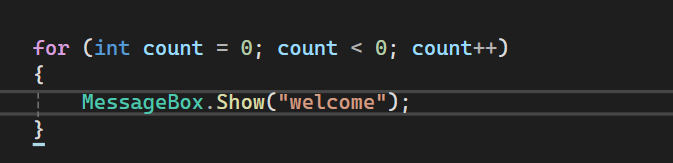
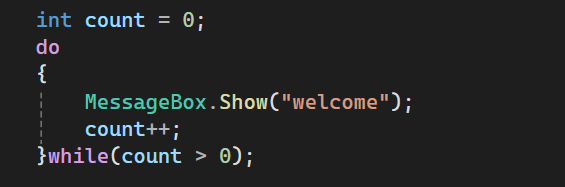

#  Loops in C#

### Chapter 4: while, ++ / --, for and do-while

*Based on: Starting Out with Visual C# (6th Edition), Tony Gaddis, Chapter 4*

---

## About This Project

A Windows Forms project that demonstrates how C# repeats code using **loops**. Each section gives a **definition**, a **code example**, and a **screenshot** of the result.

---

## Contents

| # | Topic | Screenshot file |
|:-:|---|---|
| 1 | The `while` loop | `1_while_loop.png` |
| 2 | Postfix vs Prefix | `4_postfix_prefix.png` |
| 3 | The `for` loop | `5_for_loop.png` |
| 4 | `do-while` vs `while` | `6_do_while.png` |

>  Save the screenshots in a folder named `screenshots` using the exact file names above. If this README is inside the screenshots folder, remove `screenshots/` from the image paths.

---

## 1️ The `while` Loop

**Definition:** A **while loop** repeats a statement or a set of statements **as long as a Boolean expression is true**.

**Parts of a while loop:**
- A **Boolean expression** tested for `true` or `false`.
- A **body**: the statements inside the curly braces that repeat.

| Term | Meaning |
|---|---|
| **Iteration** | One single run of the loop body |
| **Counter variable** | A variable that tracks how many times the loop runs |

**Syntax:**

while (BooleanExpression)  
{  
&nbsp;&nbsp;&nbsp;&nbsp;statements  
}  
  

> `count` starts at 0, so the loop iterates **5 times**.

### Screenshot 1

---

## 2 Postfix vs Prefix Mode

| Mode | Position | Meaning |
|---|---|---|
| **Postfix** | `x++` (operator after) | Use the **old** value, then change it |
| **Prefix** | `++x` (operator before) | **Change** the value first, then use it |

### Screenshot 4

---

## 5️ The `for` Loop

**Definition:** The **for loop** is designed for situations where a **counter variable** controls how many times the loop iterates. It is also a **pretest loop**.

**Three actions you must specify:**

| Action | Description |
|---|---|
| **Initialization** | A one-time expression that sets the starting value |
| **Test** | A Boolean expression; if `true`, the loop iterates |
| **Update** | Increases or decreases the counter |

**Syntax:**

for (InitializationExpression; TestExpression; UpdateExpression)  
{  
&nbsp;&nbsp;&nbsp;&nbsp;statements  
}  

### Screenshot 5

---

## 6️ `do-while` vs `while`

**Definition:** The **do-while loop** is a **posttest loop**: it performs an iteration **before** testing its Boolean expression. The body always runs **at least once**.

**Syntax:**

do  
{  
&nbsp;&nbsp;&nbsp;&nbsp;statements  
} while (BooleanExpression);  

⚠️ Do not forget the **semicolon** after `while (...)`.

> Same condition (`number < 0` is false), but `do-while` runs once and `while` never runs.

### Screenshot 6

---

## Quick Summary

| Loop | Type | Runs at least once? | Best used when |
|---|---|---|---|
| `while` | Pretest | No | The number of iterations is unknown |
| `for` | Pretest | No | You use a counter and know the count |
| `do-while` | Posttest | **Yes** | The body must run at least once |

---

## How to Run

1. Open the project in **Visual Studio**.
2. Press **F5** (or click Start).
3. Click each button, then take the screenshots.

---

*Made with  using C# and Windows Forms.*