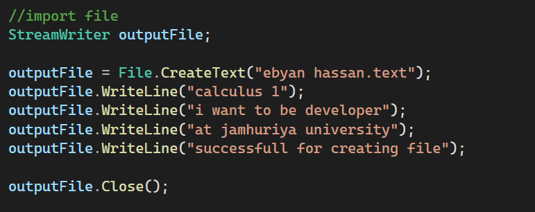
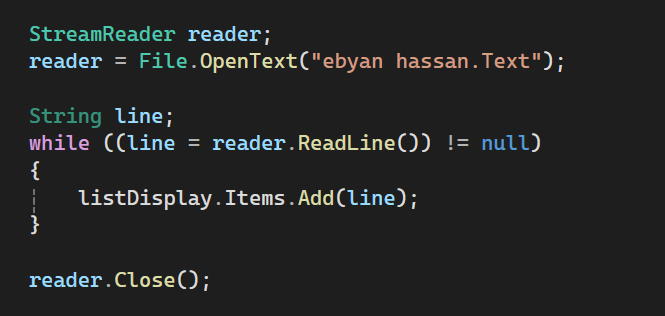
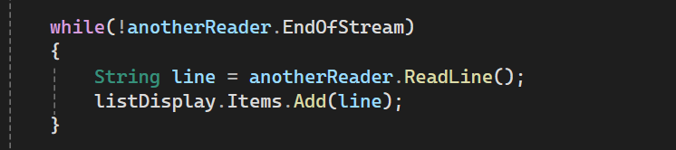
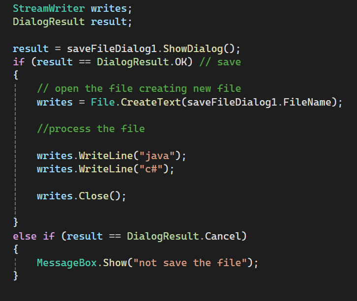

# Working with Files in C#

### StreamWriter, StreamReader, EndOfStream and OpenFileDialog

*Based on: Starting Out with Visual C# (6th Edition), Tony Gaddis, Chapter 4*

---

## About This Project

A Windows Forms project that shows how a C# program **writes** data to a text file, **reads** it back, and lets the user **choose a file** with a standard dialog box.

>  Add `using System.IO;` at the top of the form to use `File`, `StreamWriter` and `StreamReader`.

---

##  Contents

| # | Topic | Screenshot file |
|:-:|---|---|
| 1 | StreamWriter: `CreateText`, `WriteLine`, `Close` | `1_streamwriter.png` |
| 2 | StreamReader: `OpenText`, `ReadLine` with a `while` loop | `2_streamreader.png` |
| 3 | `EndOfStream` | `3_endofstream.png` |
| 4 | OpenFileDialog: `ShowDialog`, `.OK` or `.Cancel` | `4_openfiledialog.png` |

>  Save the screenshots in a folder named `screenshots` using the exact file names above. If this README is inside the screenshots folder, remove `screenshots/` from the image paths.

---

## The Three Steps of Working with Files

| Step | Description |
|:-:|---|
| 1. **Open** | Create a connection between the file and the program |
| 2. **Process** | Write to the file or read from it |
| 3. **Close** | Disconnect the file and the program |

---

## 1️ StreamWriter: CreateText, WriteLine and Close

**Definition:** **StreamWriter** is the .NET class used to **write data to a text file**.

| Part | What it does |
|---|---|
| `StreamWriter` | The file object used for writing |
| `File.CreateText("name.txt")` | Creates a new text file. If it already exists, its contents are **erased** |
| `WriteLine(item)` | Writes the item, then a **newline** (end of line) |
| `Write(item)` | Writes the item **without** a newline |
| `Close()` | Disconnects the file from the program |
  

> To **add** to an existing file without erasing it, use `File.AppendText` instead of `File.CreateText`.

### Screenshot 1

Show the code and the created file (`courses.txt`) opened in Notepad.

---

## 2️ StreamReader: OpenText and ReadLine with a while Loop

**Definition:** **StreamReader** is the .NET class used to **read data from a text file**.

| Part | What it does |
|---|---|
| `StreamReader` | The file object used for reading |
| `File.OpenText("name.txt")` | Opens an existing text file for reading |
| `ReadLine()` | Reads **one line** and returns it as a string |
| `Close()` | Disconnects the file from the program |

> The `while` loop reads the file **line by line** until there is nothing left to read.

### Screenshot 2

Show the code and the ListBox filled with the lines from the file.

---

## 3️ EndOfStream

**Definition:** `EndOfStream` is a **Boolean property** of `StreamReader` that tells whether the **end of the file** has been reached.

| Value | Meaning |
|---|---|
| `false` | There is **more data** to read |
| `true` | The **end of the file** was reached |

**Two ways to write the loop (both are equivalent):**

while (inputFile.EndOfStream == false)  
{  
&nbsp;&nbsp;&nbsp;&nbsp;// read one line  
}  

while (!inputFile.EndOfStream)  
{  
&nbsp;&nbsp;&nbsp;&nbsp;// read one line  
}  

> `!` means NOT, so `!inputFile.EndOfStream` reads as "while the end of the stream has **not** been reached".

### Screenshot 3

Show the code using `EndOfStream` and the result after reading all lines.

---

## 4️ OpenFileDialog: ShowDialog, OK or Cancel

**Definition:** **OpenFileDialog** displays the standard Windows **Open** dialog box so the user can choose a file.

- It is an **invisible control**: it appears in the **component tray** at the bottom of the Designer, not on the form.
- `ShowDialog()` displays the dialog.
- `ShowDialog()` returns a **DialogResult** that tells which button the user clicked:

| Button clicked | Value returned |
|---|---|
| Open | `DialogResult.OK` |
| Cancel | `DialogResult.Cancel` |

| Property | Description |
|---|---|
| `FileName` | Path and name of the file the user selected |
| `InitialDirectory` | The folder shown first when the dialog opens |

### Screenshot 4

Show the Open dialog, and the result after choosing a file (`OK`). You can add one more showing the Cancel message.

---

##  Quick Summary

| Item | Purpose |
|---|---|
| `StreamWriter` | Write text to a file |
| `File.CreateText` | Create a file (erases old contents) |
| `WriteLine` | Write a line of text |
| `Close` | Disconnect the file |
| `StreamReader` | Read text from a file |
| `File.OpenText` | Open a file for reading |
| `ReadLine` | Read one line |
| `EndOfStream` | `true` when the end of the file is reached |
| `OpenFileDialog` | Let the user choose a file |
| `ShowDialog` | Show the dialog and return the user's choice |
| `DialogResult.OK` / `.Cancel` | Which button the user clicked |

---

## How to Run

1. Open the project in **Visual Studio**.
2. Press **F5** (or click Start).
3. Click each button, then take the screenshots.

---

*Made with  using C# and Windows Forms.*